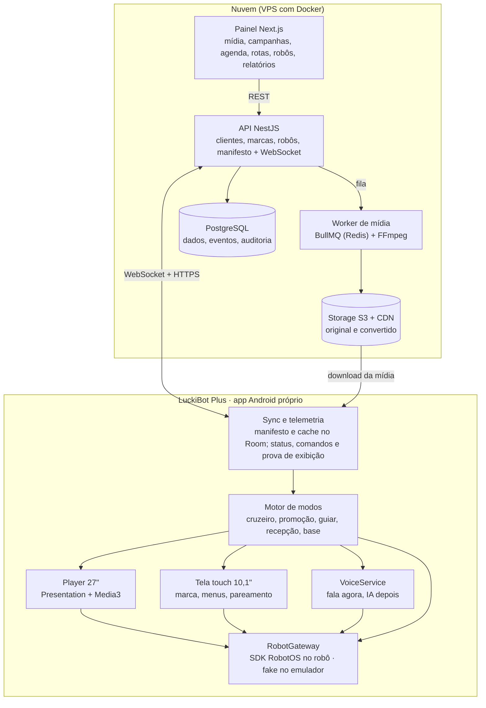

# Hostly — especificação do sistema v1 (LuckiBot Plus)

21/10/2026 · Gabriel Santos

## Objetivo e escopo

A v1 troca o app de fábrica do LuckiBot Plus por um app Android próprio, controlado por uma plataforma web multiempresa, com foco em fazer as propagandas funcionarem.

| Problema hoje | Como a v1 resolve |
| --- | --- |
| Trocar mídia é difícil | Upload no painel web; o robô baixa sozinho e confirma o recebimento |
| Não dá pra agendar | Campanhas com período, dias da semana, faixa de horário e alvo (organização, loja, robô ou ponto do mapa) |
| Tela grande falha | Todo arquivo é validado e convertido no servidor pro formato da tela; player com cache local e playlist reserva |
| Sem relatório | Registro de cada exibição (prova de exibição) + contagem anônima de pessoas na frente da tela |

**Dentro da v1:** os modos de fábrica refeitos (promoção parada, cruzeiro, guiar, recepção, volta à base), falas programadas, comandos remotos, status ao vivo e marca por cliente, com acesso próprio do cliente ao painel.

**Fora da v1:** conversa com IA (fase 5), entrega e coleta, cobrança do SaaS (fase 6).

**Sistema do robô:** o Plus roda RobotOS e a v1 é feita só pra ele; nada do AgentOS é usado. O código só fica preparado pra uma troca, caso a OrionStar um dia libere AgentOS pro Plus (seção "Preparado pro AgentOS").

## Operadora, clientes e marcas

Você é a operadora: compra os robôs, instala nos estabelecimentos e controla todos de um painel só; cada estabelecimento é um cliente com a própria marca.

**Hierarquia:** Operadora ([SUA EMPRESA]) → Clientes (Shopping A, Shopping B…) → Locais (unidade ou piso) → Robôs.

**Marca por herança.** Cada robô usa a primeira marca que encontrar, de baixo pra cima:

| Nível | Quando usa |
| --- | --- |
| Robô | Exceção pontual, ex.: tema de evento num robô só |
| Cliente | Marca do estabelecimento (ex.: Shopping A) |
| Operadora | Padrão quando o cliente não tem marca, ou em robôs próprios (feira, demo, evento) |

**Perfil de marca:**

- Nome e logo
- Cores: primária, fundo do robô, destaque
- Fonte de títulos
- Nome do robô e saudação (ex.: "Oi, eu sou a [NOME DO ROBÔ] do Shopping A")
- Voz do TTS
- Tela de espera e playlist padrão
- Selo "operado por [SUA EMPRESA]" (liga e desliga)

**Acessos:**

| Papel | Vê e faz |
| --- | --- |
| Operadora | Tudo: todos os clientes, robôs, marcas, campanhas e relatórios |
| Cliente | Só os próprios locais e robôs: mídia, campanhas, falas e relatórios; não muda configuração técnica |
| Anunciante | Sobe mídia das próprias campanhas e vê o relatório delas |

**Anunciantes:** os lojistas de cada cliente podem comprar espaço na tela de 27". Cada campanha pode pertencer a um anunciante, e a prova de exibição vira a base da cobrança: o cliente paga pelo robô e os lojistas pagam pela mídia.

**Mudar o robô de lugar:** trocar o local dele no painel. A marca e a programação do novo local chegam na próxima sincronização, sem reinstalar nada.

## Regras do robô que mandam no desenho

Tudo aqui vem da documentação da OrionStar; o agente de código precisa respeitar cada item.

1. **App próprio desliga os modos de fábrica.** Com APK próprio, funções originais como patrulha e recepção [deixam de ficar disponíveis](https://doc.orionstar.com/en/knowledge-base/build-robot-app/); a v1 refaz o que for usado.
2. **Só em primeiro plano.** O SDK dá o controle do chassi só pra app em primeiro plano; serviço em background não conecta ([RobotAPI](https://github.com/orionagent/agentos-sdk/blob/main/Robot/v11.3C/RobotAPI_en.md)).
3. **Abrir pela Home do RobotOS.** Run/Debug do Android Studio não carrega as capacidades do robô. Abrir pelo ícone (três dedos pra baixo → todos os apps) ou como app de boot ([FAQ](https://doc.orionstar.com/en/faq-category/apk-faq/)).
4. **O sistema pode tomar o controle.** Em emergência, bateria baixa ou OTA chega `onSuspend`; todas as chamadas param de valer até `onRecovery`.
5. **Um recurso de chassi por vez.** Navegar, seguir pessoa e mover não rodam juntos (erros -1 e -6).
6. **Cruzeiro não ****tem API documentada****.** A doc só traz navegação ponto a ponto (`startNavigation`) e um status de cruzeiro; o plano é um loop do app sobre os pontos. Se o jar tiver uma API de cruzeiro, avaliar na fase 0.
7. **Mapa e pontos vêm da Map Tool do robô.** O app só lê (`getPlaceList`); pontos ficam ligados ao mapa atual.
8. **Visão x câmera.** Abrir a câmera direto derruba a detecção de pessoas: usar `PersonApi` ou o fluxo compartilhado 640×480. A câmera do topo do Lucki não é aberta ao SDK, e a câmera via API Android vem girada 90°.
9. **Plus = chassi Lucki + tela grande.** Nas tabelas de suporte da doc vale a coluna "Lucki" pro chassi e o guia BigScreenBot pra tela; o BigScreenBot em si não navega. Algumas APIs marcam Lucki como "não" (recarga por API, bateria via `RobotSettingApi`): validar no Plus.
10. **Voz:** cada fala até 300 caracteres (máx. 1.000); áudio bruto só com parâmetros fixos (16 kHz, estéreo, PCM 16 bits).
11. **Logs do robô:** `adb pull /sdcard/logs/offlineLogs/821/`.

## Arquitetura

A nuvem decide e entrega; o robô executa sozinho com o último manifesto que recebeu.


_O que mantém o robô rodando sem internet: o bloco Sync e telemetria._

- **Offline primeiro.** Sem internet, o robô segue a agenda, toca a mídia em cache e guarda os eventos pra mandar depois.
- **Nuvem decide, robô executa.** A agenda chega pronta no manifesto; o robô só compara com o relógio local.
- **Multiempresa desde o início.** Tudo pendura numa Organization.
- **Hardware isolado.** Todo acesso ao SDK passa pelo `RobotGateway`: dá pra rodar no emulador e, se um dia vier AgentOS, trocar só essa camada.

## Stack e estrutura do repositório

Tudo em TypeScript no servidor e Kotlin no robô, num único repositório.

| Camada | Escolha | Motivo |
| --- | --- | --- |
| Monorepo | pnpm workspaces + Turborepo | Um repo pra API, painel, worker e app |
| API | NestJS + Prisma + PostgreSQL, partindo do seu boilerplate SaaS (Workspace + Membership) | Multiempresa e papéis já resolvidos |
| Fila | Redis + BullMQ | Jobs de conversão de mídia e recompilação de manifesto |
| Mídia | Storage S3 compatível (MinIO local; R2 ou S3 em produção) + CDN; FFmpeg no worker | Robô baixa direto do CDN |
| Painel | Next.js (App Router) + TanStack Query | Mesma stack que você já usa |
| Tempo real | WebSocket nativo (`@nestjs/platform-ws`) | Cliente simples no Android com OkHttp |
| Contratos | Pacote `contracts` com schemas Zod exportados em JSON Schema | Robô e servidor falam o mesmo formato |
| App do robô | Kotlin, coroutines, Room, WorkManager, OkHttp, Media3/ExoPlayer, `robotservice.jar` | Offline primeiro; conferir minSdk contra o Android do robô |
| Local | Docker Compose no OrbStack (Postgres, Redis, MinIO) | Sobe tudo com um comando |
| Produção | VPS com Docker; CDN na frente do bucket | Começa barato, escala depois |

```text
hostly/
├── apps/
│   ├── api/              # NestJS
│   ├── worker/           # BullMQ + FFmpeg
│   ├── web/              # Next.js (painel)
│   └── robot/            # projeto Gradle (Kotlin), fora do pnpm
│       ├── libs/             # robotservice.jar da ROM testada
│       ├── app/              # Activity principal, UI touch, pareamento
│       ├── core-robot/       # RobotGateway: impl RobotOS + fake (único que importa a OrionStar)
│       ├── core-data/        # Room, manifesto, downloads, WebSocket, eventos, comandos
│       ├── core-ui/          # tema da marca
│       ├── feature-player/   # Presentation da tela de 27" e player de música
│       └── feature-modes/    # motor de modos
├── packages/
│   ├── contracts/        # schemas: manifesto, comandos, eventos
│   └── config/           # eslint, tsconfig
├── docs/                 # spec.md, spikes.md, orionstar.md
├── docker-compose.yml
└── CLAUDE.md
```

## Modelo de dados

Toda tabela de negócio leva `organizationId` (a operadora) e, quando é de um cliente, `clientId`; usuário de cliente só enxerga o próprio `clientId`, e o robô só enxerga o que o token dele permite.

| Entidade | Campos principais | Observação |
| --- | --- | --- |
| Organization | name, slug, plan | A operadora; raiz do tenant (o Workspace do boilerplate) |
| Client | organizationId, name, brandProfileId, status | Estabelecimento atendido (ex.: Shopping A) |
| BrandProfile | ownerType, ownerId, name, logoKey, primaryColor, backgroundColor, accentColor, titleFont, robotName, greeting, ttsVoice, idleAssetId, defaultPlaylistId, showOperatorSeal | Dono: operadora, cliente ou robô |
| Advertiser | clientId, name, contact | Lojista que compra espaço na tela |
| User, Membership | role: operator_admin, operator_staff, client_admin, client_editor, advertiser; clientId e advertiserId opcionais | Papel + escopo |
| Site | clientId, name, timezone, address | Local do cliente; o fuso decide a agenda |
| Robot | serial, model, siteId, brandProfileId (opcional), name, romVersion, appVersion, status, lastSeenAt, deviceTokenHash | Entra por pareamento; marca própria só se for exceção |
| MapPoint | robotId, mapName, name, x, y, theta | Sincronizado de `getPlaceList` |
| Route, RoutePoint | order, pointName, dwellSec, speechScriptId | Rota de cruzeiro |
| MediaAsset | clientId, advertiserId, type, originalKey, status, durationMs, width, height | status: processing, ready, failed |
| MediaRendition | assetId, profile, key, checksum, sizeBytes | Uma por perfil de tela |
| Playlist, PlaylistItem | order, assetId, imageDurationSec | Imagem precisa de duração |
| Campaign | clientId, advertiserId, name, startsAt, endsAt, priority, status | Anunciante opcional |
| CampaignSchedule | campaignId, daysOfWeek, startTime, endTime, targetType, targetId | Alvo: cliente, site, robot ou point |
| SpeechScript | lines, trigger, intervalSec | trigger: on_person, at_point, interval |
| ModeSchedule | robotId, mode, daysOfWeek, startTime, endTime, routeId, pointName | Ex.: cruzeiro das 10h às 14h, base à noite |
| Manifest | robotId, version, payload, createdAt | Inclui o perfil de marca efetivo; version = hash do conteúdo |
| PlayEvent | robotId, assetId, campaignId, advertiserId, startedAt, endedAt, completed, pointName, peopleMax | Prova de exibição, base da cobrança |
| AudienceSample | robotId, ts, faces, bodies | Agregado por minuto, só contagem |
| Command | robotId, type, payload, status, issuedBy, ackAt, result | Fila de comandos remotos |
| TelemetrySnapshot | robotId, ts, battery, charging, pose, mode, emergency | Último estado + histórico curto |
| AuditLog | actorId, action, entity, entityId | Quem mudou o quê |

## Pipeline de propaganda

É o núcleo da v1: cada etapa existe pra eliminar um dos quatro problemas.

1. **Upload.** O painel pede uma URL assinada e o navegador sobe direto pro storage; a API cria o MediaAsset como `processing`.
2. **Validação e conversão (worker).** `ffprobe` lê codec, resolução e duração; o FFmpeg gera uma versão por perfil de tela. Se falhar, o asset vira `failed` com motivo legível no painel.
3. **Playlist e campanha.** O editor monta a playlist e cria a campanha com período, prioridade e regras de agenda.
4. **Manifesto.** A cada mudança, a API recompila o manifesto de cada robô afetado: agenda resolvida dos próximos 7 dias, perfil de marca efetivo do robô e lista de arquivos com checksum. A versão é o hash do conteúdo.
5. **Aviso.** A API manda `manifest.updated` pelo WebSocket; o robô também consulta a cada 5 minutos, caso o aviso se perca.
6. **Download.** O WorkManager baixa só o que falta, confere o checksum e troca de versão de forma atômica. Mídia sem uso há 7 dias é apagada.
7. **Execução.** O motor de modos lê a agenda pelo relógio local + fuso do site e manda o player tocar.
8. **Prova de exibição.** Cada item tocado gera um PlayEvent (início, fim, se completou, ponto, pico de pessoas), guardado no Room e enviado em lote.

**Perfis de tela** (parâmetros de partida; ajustar no spike da fase 0):

| Perfil | Resolução | Vídeo | Imagem |
| --- | --- | --- | --- |
| `big_27` | 1080×1920, retrato | H.264, 30 fps, áudio AAC, `faststart`, até ~8 Mbps | JPEG ou WebP 1080×1920 |
| `head_10` | 1200×1920, retrato | Mesmo padrão | JPEG ou WebP 1200×1920 |

**Regras de agenda:**

- No mesmo horário vence a campanha de maior prioridade; empate intercala os itens.
- Sem campanha ativa toca a playlist padrão da organização: nunca tela preta.
- Arquivo corrompido no robô é pulado e vira evento de erro.
- Campanha com alvo em ponto toca quando o cruzeiro para naquele ponto.
- O painel avisa conflito de agenda e proporção errada antes de publicar.

## Protocolo robô ↔ nuvem

REST pra coisas grandes e idempotentes, WebSocket pra status e comandos; todos os formatos ficam em `packages/contracts`.

**Pareamento:** sem token, o app mostra um código de 6 dígitos na tela touch; o admin digita no painel e o robô recebe um token próprio, revogável.

| Método | Rota | Uso |
| --- | --- | --- |
| POST | `/device/pair` | Troca o código de pareamento pelo token do robô |
| GET | `/device/manifest?since=<versão>` | Baixa o manifesto atual (304 se não mudou) |
| GET | `/device/media/:renditionId` | Devolve URL assinada do CDN |
| POST | `/device/events` | Lote de PlayEvent, AudienceSample e erros |
| POST | `/device/map-points` | Envia os pontos lidos com `getPlaceList` |

| Direção | Mensagem | Conteúdo |
| --- | --- | --- |
| robô → nuvem | `hello` | serial, appVersion, romVersion, manifestVersion |
| robô → nuvem | `telemetry` | A cada 10 s: bateria, carregando, pose, modo, item tocando, emergência |
| robô → nuvem | `command.result` | id, ok ou erro, mensagem |
| nuvem → robô | `manifest.updated` | Nova versão |
| nuvem → robô | `command` | id + tipo: `go_to_point`, `start_route`, `stop`, `speak`, `set_mode`, `play_now`, `dock`, `set_volume`, `sync_map` |
| ambos | `ping` / `pong` | A cada 30 s; 3 faltas = offline |

Comando sem `command.result` em 60 s vira `timeout` no painel. Todo comando é registrado no AuditLog.

## App Android

Uma Activity principal em primeiro plano (exigência do SDK) segura tudo; a tela de 27" é uma `Presentation` na segunda tela.

- **RobotGateway.** Interface Kotlin com navegação, fala, visão, energia e sistema. `RobotOsGateway` usa o `robotservice.jar`; `FakeRobotGateway` simula pontos, bateria e fala pra rodar no emulador. Nenhum módulo fora de `core-robot` importa classes da OrionStar.
- **Ciclo de vida do SDK.** `connectServer` na Application, registra `ModuleCallback` e listeners (`STATUS_BATTERY`, `STATUS_POSE`, `STATUS_EMERGENCY`). `onSuspend` pausa o motor de modos; `onRecovery` retoma; desconexão tenta reconectar.
- **Tela de 27".** `DisplayManager` → `Presentation`, permissão `SYSTEM_ALERT_WINDOW`, ajuste de proporção do guia BigScreenBot. Player Media3 em loop com vigia: sem quadro novo por alguns segundos, reinicia o item e registra erro.
- **Kiosk.** App de boot (`action.orionstar.default.app` + Boot Apps). Opcional: `disableFunctionKey` (botão da cabeça) e cores da marca nas luzes do pé (`playMultipleColor`).
- **Offline.** Room guarda manifesto, índice de arquivos e fila de eventos; o robô cumpre a agenda sem rede. O tema (logo, cores, fonte, nome do robô, saudação) também vem do manifesto e é aplicado na hora: nenhuma marca fica fixa no código.
- **Voz.** Interface `VoiceService` (falar, ouvir, intenção). Implementação RobotOS com `SkillApi`. Se um dia o Plus ganhar AgentOS, entra uma segunda implementação sem mexer no resto.
- **Visão.** `PersonApi` conta pessoas e dispara saudação; o app nunca abre a câmera direto.

| Modo | Entra quando | O que faz | Sai quando |
| --- | --- | --- | --- |
| Promoção | Agenda ou comando | Parado num ponto: playlist do ponto, falas por intervalo, saudação ao ver pessoa | Fim da janela ou comando |
| Cruzeiro | Agenda ou comando | Percorre a rota em loop com `startNavigation`, para `dwellSec` em cada ponto e toca a campanha dele | Fim da janela, bateria baixa ou comando |
| Guiar | Toque em "me leve até" na tela touch | Navega até o destino e volta ao modo anterior | Chegada, erro ou timeout |
| Recepção | Pessoa a até 2 m durante a promoção | Fala de saudação + conteúdo na tela touch | Pessoa sai do campo de visão |
| Base | Fora do horário ou comando | Vai pra base e entra em standby (`robotStandby`) | Início da próxima janela |
| Suspenso | `onSuspend` do sistema | Nada; mostra o estado na tela touch | `onRecovery` |

## Preparado pro AgentOS

O Plus roda RobotOS e a v1 depende só dele; estas regras deixam uma troca futura restrita a poucas classes.

| Camada | Hoje (RobotOS) | Se o Plus ganhar AgentOS |
| --- | --- | --- |
| Hardware (`RobotGateway`) | `RobotOsGateway` com `robotservice.jar` | Quase igual: o AgentOS SDK já embute a RobotAPI |
| Voz (`VoiceService`) | `RobotOsVoiceService` com `SkillApi` | Nova `AgentOsVoiceService`; no AgentOS a voz da RobotAPI fica desativada |
| IA | No backend (fase 5) | Continua no backend; `isDisablePlan` desliga o planejamento do LLM do AgentOS |
| Build | Versões que a ROM atual aceita | Sobe pra Java 11 e Android 8+ (API 26); versões centralizadas no version catalog do Gradle |

- Nenhum ASR ou TTS chamado fora do `VoiceService`.
- Nada de skills, intents ou NLP de fábrica do RobotOS: a lógica de conversa fica no backend.
- A implementação de cada interface é escolhida num único ponto (injeção de dependência), nunca com `if` espalhado.

## Painel web

Treze páginas cobrem a v1; a ordem é a de prioridade. Usuário de cliente vê as mesmas páginas, só com os dados dele e sem Clientes nem Marcas da operadora.

| Página | Faz |
| --- | --- |
| Biblioteca de mídia | Upload, status da conversão, prévia por perfil de tela, filtro por cliente e anunciante |
| Playlists | Montar e ordenar itens, duração das imagens |
| Campanhas | Período, prioridade, regras de agenda, anunciante, calendário semanal com conflitos |
| Robôs | Status ao vivo, pontos do mapa, comandos (ir, falar, parar, trocar modo), local e marca em uso |
| Clientes | Cadastro dos estabelecimentos, locais de cada um, robôs ligados e acessos |
| Marcas | Perfis de marca com prévia das duas telas do robô ao vivo |
| Anunciantes | Lojistas de cada cliente, campanhas e acesso deles |
| Agenda de modos | O que cada robô faz em cada horário |
| Rotas | Montar o cruzeiro escolhendo e ordenando pontos do mapa |
| Falas | Roteiros e gatilhos (ao ver pessoa, no ponto, por intervalo) |
| Relatórios | Exibições por cliente, anunciante, campanha, mídia, robô e dia; pessoas; horas por modo; export CSV |
| Dashboard | Visão geral da frota inteira e alertas |
| Configurações | Usuários e papéis, parear robô, marca da operadora |

## Cara do projeto

A identidade abaixo é a padrão da operadora; cada cliente troca logo, cores e textos pelo perfil de marca, sem mexer no layout.

| Cor | Hex | Uso |
| --- | --- | --- |
| Azul Órbita | `#1F6FEB` | Botões, destaques, fundo das propagandas |
| Azul Profundo | `#1558D6` | Links e texto azul sobre fundo claro |
| Noite | `#0A1A3F` | Fundo das telas do robô e menu do painel |
| Gelo | `#7CC4FF` | Olhos do robô e destaques no escuro |
| Névoa | `#F4F7FC` | Fundo do painel |
| Tinta | `#0B1530` | Texto principal |

- **Tipografia:** Sora nos títulos, IBM Plex Sans nos textos, IBM Plex Mono em códigos e números.
- **Contraste:** branco sobre Azul Órbita dá 4,6:1 (passa AA). Texto azul em fundo claro usa o Azul Profundo, porque o Órbita fica abaixo de 4,5:1 na Névoa.
- **Robô:** fundo Noite nas duas telas, botões grandes na tela touch, olhos em Gelo na recepção e no cruzeiro. A tela de 27" usa títulos enormes, pra ler a alguns metros.
- **Painel:** fundo Névoa, menu lateral Noite, cards brancos.
- **Marca do cliente:** só as cores primária, de fundo e de destaque, a fonte de títulos e os textos mudam; espaçamento, tamanhos e componentes ficam fixos, pra nenhuma marca quebrar a leitura. O painel avisa quando a cor do cliente não passa contraste com o texto.

**Protótipo navegável:** [LuckiBot Plus — protótipo](https://claude.ai/artifact/9jHqzkYd2rRPRrvvcPdFFo)

- Robô: tela touch e tela de 27" juntas, com simulação de modos e eventos (pessoa chegando, bateria baixa, emergência, sem internet, pareamento)
- Identidade visual
- Painel (12 telas, todas com o mesmo menu): Visão geral, Robôs, Agenda e rotas, Mídia, Playlists, Campanhas, Falas, Clientes, Marcas (com prévia do robô), Anunciantes, Relatórios e Configurações (pareamento e papéis)

## Mapa de APIs do robô

Cada necessidade da v1 ligada à API documentada; "validar" significa que a doc não garante o comportamento no Plus.

| Necessidade | API | Situação no Plus |
| --- | --- | --- |
| Conectar e receber eventos | `RobotApi.connectServer` + `ModuleCallback` | Documentado |
| Serial e versão | `getRobotSn`, `getVersion` | Lucki: sim |
| Pontos do mapa | `getPlaceList`, `getMapName` | Documentado |
| Posição | `getPosition`, `STATUS_POSE` | Documentado |
| Navegar | `startNavigation`, `stopNavigation` | Lucki: sim |
| Cruzeiro | Loop de `startNavigation` | Não documentado; conferir no jar |
| Movimento básico | `goForward`, `turnLeft`, `stopMove` | Documentado |
| Falar | `SkillApi.playText`, `stopTTS` | Validar PT-BR |
| Ouvir | `SkillCallback` (ASR); áudio bruto 16 kHz | Validar PT-BR |
| Pessoas | `PersonApi.getAllPersons`, `registerPersonListener` | Lucki: sim |
| Câmera | `SurfaceShareApi` (640×480) ou Camera2 com rotação | Câmera do topo fechada ao SDK |
| Bateria | `STATUS_BATTERY` | Validar (`RobotSettingApi` marca Lucki "não") |
| Ir pra base | `startNaviToAutoChargeAction` | Validar (doc marca Lucki "não"); plano B: navegar até o ponto da base |
| Emergência | `STATUS_EMERGENCY` | Documentado |
| Standby | `robotStandby`, `robotStandbyEnd` | Só Lucki |
| Botão da cabeça | `disableFunctionKey` | Só Lucki |
| Luzes | `playMultipleColor` (15 LEDs do pé) | Só Lucki |
| Vários robôs | `STATUS_MULTIPLE_ROBOT_WORKING` | Lucki com módulo ESP32 |
| Tela de 27" | `Presentation` + guia BigScreenBot | Validar |
| Logs | `adb pull /sdcard/logs/offlineLogs/821/` | Via ADB |

## Fases de implementação

Uma fase por vez; cada uma só fecha quando o critério de pronto passa no robô de verdade.

**Fase 0 — Spikes no robô.** Antes de qualquer código grande. Pronto quando cada item tem resultado anotado em `docs/spikes.md`:

- [ ] ADB liberado e versão do Android anotada (`adb shell getprop ro.build.version.sdk`)
- [ ] RobotSample compila com o jar da ROM e roda aberto pela Home
- [ ] `Presentation` aparece na tela de 27" com vídeo H.264 1080×1920 por 1 hora sem travar
- [ ] `getPlaceList` devolve os pontos e `startNavigation` roda em loop por 3 pontos
- [ ] Fala e reconhecimento em PT-BR
- [ ] `STATUS_BATTERY`, `STATUS_EMERGENCY`, `onSuspend` e `onRecovery` chegam
- [ ] Ir pra base funciona, por API ou navegando até o ponto
- [ ] `PersonApi` conta pessoas com o player rodando; uso de CPU anotado
- [ ] `robotStandby`, `disableFunctionKey` e `playMultipleColor` funcionam
- [ ] Dá pro app se atualizar sozinho, ou só por ADB?

1. **Fase 1 — Fundação.** Monorepo, Docker Compose, API a partir do boilerplate (operadora, clientes, usuários, papéis e escopo por cliente), Site e Robot, pareamento, WebSocket com `hello`, `telemetry` e `ping`. No Android: RobotGateway (real + fake), conexão ao SDK, tela de pareamento. *Pronto quando* o robô aparece online no painel com bateria e posição.
2. **Fase 2 — Propaganda.** Perfil de marca com herança e tema aplicado no robô, upload + worker, playlists, campanhas, agenda, manifesto, sync offline, player na 27", playlist padrão, PlayEvent. *Pronto quando* uma campanha agendada no painel toca no horário certo com a internet desligada e o relatório mostra as exibições depois que a rede volta.
3. **Fase 3 — Modos.** Promoção, cruzeiro com rotas, falas, recepção, guiar pela tela touch, base e standby fora do horário, agenda de modos, comandos remotos. *Pronto quando* o robô cumpre um dia inteiro de agenda sem ninguém mexer.
4. **Fase 4 — Relatórios e operação.** Acesso do cliente e de anunciantes ao painel, relatórios por cliente e anunciante, dashboards, export CSV, alertas (offline, bateria, emergência, erro de mídia), logs remotos, auditoria.
5. **Fase 5 — IA conversacional.** `VoiceService` com ASR, LLM no backend e TTS; base de conhecimento por organização.
6. **Fase 6 — SaaS.** Planos e cobrança, onboarding de cliente, marca por cliente no app do robô.

## Riscos e decisões em aberto

Os riscos maiores se resolvem na fase 0; cada um já tem plano B.

| Risco | Plano B |
| --- | --- |
| Voz não entende ou não fala PT-BR | ASR e TTS externos, com áudio bruto do microfone |
| Tela de 27" não aparece como segundo display Android | Pedir à OrionStar a API da tela; até lá, conteúdo só na tela touch |
| Ir pra base por API não funciona no Lucki | Navegar até o ponto da base e deixar o sistema encaixar |
| Sistema bloqueia o app de se atualizar | Atualização por ADB ou suporte; avaliar MDM depois |
| Atualização de ROM quebra o jar | Versão do jar fixada no repo e ROM testada registrada em `docs/spikes.md` |
| LGPD | Só contagens saem do robô, nenhuma imagem; aviso no local |

- [ ] Nome do produto e domínio
- [ ] Storage em produção: Cloudflare R2 ou AWS S3
- [ ] Provedor da VPS
- [ ] Manter o app de fábrica instalado como reserva ou não

## Como usar com o agente de código

Exporte este doc em Markdown como `docs/spec.md` na raiz do repo e trabalhe uma fase por vez.

1. Crie o repo vazio, coloque `docs/spec.md` e um `CLAUDE.md` curto com: stack, comandos, estrutura de pastas e as regras abaixo.
2. Peça ao agente o plano da fase atual a partir do spec, revise e só depois libere a implementação.
3. Comece pela fase 0 com você ao lado do robô: o agente escreve os testes, você instala, roda e cola o resultado em `docs/spikes.md`.
4. Feche cada fase pelo critério de pronto, não pela lista de tarefas.

**Regras pro ****`CLAUDE.md`****:**

- O alvo é RobotOS: nenhuma dependência do AgentOS SDK na v1.
- Nada fora de `core-robot` importa classes da OrionStar; todo acesso ao robô passa pelo `RobotGateway`, e toda voz pelo `VoiceService`.
- Nenhuma marca fixa no código: logo, cores, fonte e textos vêm do perfil de marca no manifesto.
- O app é testado no emulador com `FakeRobotGateway`. No robô, instala por ADB e abre pela Home: Run/Debug do Android Studio não funciona.
- Contratos (manifesto, comandos, eventos) mudam primeiro em `packages/contracts`.
- Toda query de negócio filtra por `organizationId`, e por `clientId` quando o usuário é de cliente.
- O robô nunca depende de rede pra tocar a agenda.

## Fontes

- [RobotAPI do RobotOS — referência completa (hospedada no repo do AgentOS SDK)](https://github.com/orionagent/agentos-sdk/blob/main/Robot/v11.3C/RobotAPI_en.md)
- [RobotSample — exemplo oficial (GitHub)](https://github.com/OrionStarGIT/RobotSample)
- [AgentOS SDK v0.4.12 — só referência pra preparação futura](https://github.com/orionagent/agentos-sdk/blob/main/Agent/v0.4.12/AgentOS_SDK_Doc_v0.4.12_en.md)
- [Docs RobotOS: Build Robot App](https://doc.orionstar.com/en/knowledge-base/build-robot-app/), [SDK Access](https://doc.orionstar.com/en/knowledge-base/sdk-access/), [Navegação](https://doc.orionstar.com/en/knowledge-base/navigation/), [Voz](https://doc.orionstar.com/en/knowledge-base/speech-ability/), [Visão](https://doc.orionstar.com/en/knowledge-base/visual-ability/), [Câmera](https://doc.orionstar.com/en/knowledge-base/camera-data-stream-sharing/), [Energia](https://doc.orionstar.com/en/knowledge-base/power-control/), [Funções de sistema](https://doc.orionstar.com/en/knowledge-base/system-functions/), [BigScreenBot](https://doc.orionstar.com/en/knowledge-base/bigscreenbot-development/), [Modo desenvolvedor](https://doc.orionstar.com/en/knowledge-base/open-developer-mode-2/)
- [FAQ de APK](https://doc.orionstar.com/en/faq-category/apk-faq/) e [como pegar logs](https://doc.orionstar.com/en/faq/how-to-get-machine-logs/)
- [LuckiBot Plus — página oficial](https://en.orionstar.com/luckibot_plus.html)
- [Reichelt — modos de operação do LuckiBot](https://www.reichelt.com/magazin/en/news-en/service-robotics-in-practice-which-solution-is-best-suited-to-which-application/)
- [Viabilidade — doc anterior](https://claude.ai/artifact/JAWEdk2mdmgk8Lfydfcfaq)
